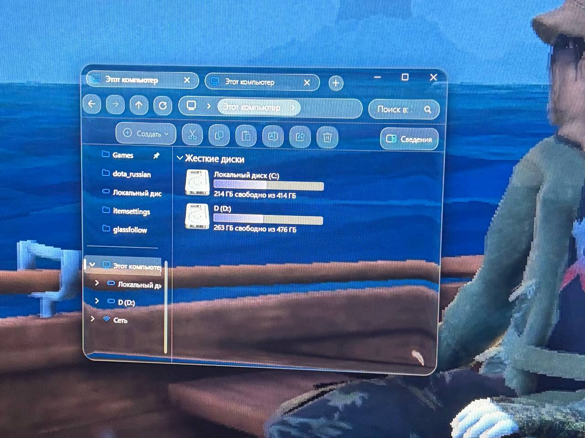

# GlassFollow

Apple-style **liquid glass** (real edge refraction, not just blur) behind your windows on **Windows 11**.

GlassFollow puts a GPU-rendered glass surface directly *under* chosen app windows and keeps it glued to them
as they move, resize, change monitors or get re-ordered. It was built for heavily customised desktops where
apps are already transparent (Zen Browser, File Explorer, Discord with Vencord, Steam with Millennium,
Windows Terminal, ...).

> Русская версия: [README.ru.md](README.ru.md)



## How it works

1. The screen is captured with `Windows.Graphics.Capture` (one session per monitor, no cursor, no border).
2. The pixel shader from [correct-liquid-glass](https://github.com/Shram1404/correct-liquid-glass) bends the
   captured image around the window's edges (refraction, bevel, highlights).
3. The result is shown in a borderless window stacked **right below** the target window and cut to its
   rounded shape. For this to be visible the **target app must be transparent**.
4. Glass windows are hidden from capture (`WDA_EXCLUDEFROMCAPTURE`), so glass never refracts itself.
   The optional Windhawk mod hides the *target* windows from capture too, otherwise the glass would refract the
   app's own contents.
5. It only re-renders when pixels under a window actually changed, and pauses completely while a fullscreen
   app (game) has focus.

## Requirements

- Windows 11 22H2 or newer (the capture and DWM features used need build 22621+).
- [.NET 10 Runtime](https://dotnet.microsoft.com/download/dotnet/10.0) (x64).
- A GPU with Direct3D 11.
- [Windhawk](https://windhawk.net) for the `glass-prep` mod (recommended, see below).
- Target apps that can be transparent.

## Quick start

1. Download the latest zip from **Releases** and unpack it somewhere permanent.
2. Install the Windhawk mod (see [Windhawk mod](#windhawk-mod)).
3. Run in PowerShell from the unpacked folder:

```powershell
.\GlassFollow.exe --thick 60 zen explorer:CabinetWClass "explorer:#32770" discord WindowsTerminal
```

Stop with `Ctrl+C` (or `Stop-Process -Name GlassFollow` when it runs hidden).

## Command line

```
GlassFollow.exe [options] <spec> [<spec> ...]
GlassFollow.exe --list [--delay N]
```

| Option | Default | Meaning |
|---|---|---|
| `--corner N` | `22` | Corner radius in pixels (at 100% scaling). |
| `--thick N` | `36` | Edge thickness of the glass. Bigger = wider refraction zone. The author uses `180`. |
| `--fps N` | `200` | Frame cap. Set it to your monitor's refresh rate. |
| `--pad N` | `16` | Margin around the window used for sampling. Raise it together with `--thick`. |
| `--hidden` | off | Hide the console window (for autostart). |
| `--list` | | Print visible windows (process, class, size, title) to build specs, then exit. |
| `--delay N` | `0` | With `--list`: wait N seconds first, so you can open the window you need. |

### Window specs

```
process[:WindowClass[:TitleSubstring]]
```

- `process` is the process name without `.exe`; `*` matches any process.
- `WindowClass` may end with `*` for a prefix match.
- A bare `process` only matches normal top-level windows. If you give a class or title, owned windows
  (dialogs), tool windows and thin windows (like launchers) are allowed too.
- Quote specs that contain `#` or `*`.

Specs that worked for the author:

| App | Spec |
|---|---|
| Zen Browser | `zen` |
| File Explorer | `explorer:CabinetWClass` |
| Explorer dialogs (delete, properties, ...) | `"explorer:#32770"` |
| Discord (Vencord) | `discord` |
| Steam (Millennium) | `steamwebhelper:SDL_app` |
| Windows Terminal | `WindowsTerminal` |
| Classic console window (cmd/PowerShell) | `"*:ConsoleWindowClass"` |
| Flow Launcher | `"Flow.Launcher:HwndWrapper*"` (experimental) |

Class names can differ between app versions. If an app is not picked up, run `GlassFollow.exe --list` and use
the values it prints.

## Windhawk mod

`windhawk/glass-prep.wh.cpp` is a small [Windhawk](https://windhawk.net) mod. Inside the apps listed in its
`@include` lines it:

- turns requests for Mica/Acrylic into "no backdrop" and applies a fully transparent accent, so the window is
  **plain transparent without blur**;
- hides the app's windows from screen capture, so the glass does not refract the window itself.

Install: Windhawk → *Create a new mod* → paste the contents of `glass-prep.wh.cpp` → *Compile Mod* → enable.
Edit the `@include` lines to choose the apps (`zen.exe`, `explorer.exe`, `discord.exe`, `steamwebhelper.exe`,
`Flow.Launcher.exe`, `WindowsTerminal.exe`, `conhost.exe`, `OpenConsole.exe` by default).

Settings:

| Setting | Meaning |
|---|---|
| Hide windows from screen capture | Needed for clean glass. Also hides the windows from screenshots, recordings and screen sharing. |
| Transparency method | `1` transparent accent (default), `2` accent + frame extended into client area, `3` backdrop "none" + frame extended. Try the next one if a window stays black or grey. |

Notes:

- Apps still need their own transparency enabled (for example Zen's transparency mod and `about:config`
  options). The mod only removes the blur/Mica and the opaque backdrop.
- In `explorer.exe` the mod only touches File Explorer windows and standard dialogs, never the desktop,
  wallpaper or taskbar.
- The mod runs inside the target processes. Read the source before enabling it, and disable it first if an app
  misbehaves.

## Games and fullscreen apps

While a window that covers a whole monitor (exclusive or borderless fullscreen) has focus, GlassFollow pauses:
the glass stays exactly as it was, nothing is re-rendered and the capture drops to one tick per second.
Normal maximized windows do not count. It resumes when the focus leaves. Do not add games to the mod's
`@include` list.

## Autostart

From the unpacked release folder:

```powershell
.\scripts\install-autostart.ps1
# or with your own apps:
.\scripts\install-autostart.ps1 -Arguments '--thick 60 zen discord "explorer:#32770"'
```

It registers a Task Scheduler task that starts GlassFollow hidden 15 seconds after logon.
Remove it with `.\scripts\uninstall-autostart.ps1`. Keep the folder where it is: the task points to the exe
(and `liquid-glass.hlsl` must stay next to it).

## Troubleshooting

| Problem | What to try |
|---|---|
| App is black or grey instead of transparent | Switch the mod's transparency method (1 → 2 → 3), then restart the app. Make sure no other mod forces Mica/blur on it. |
| No glass at all | The app is not transparent, or the spec does not match. Check `--list`. The console shows how many glass windows exist. |
| Glass shows a "ghost" of the window itself | The mod is not active for that app, or "Hide windows from screen capture" is off. |
| Window is missing from screenshots/recordings | By design while the mod's capture hiding is on. Turn it off for screenshots (the glass will then refract the window). |
| Edge refraction is too thin or cut off | Raise `--thick` and `--pad`. |
| Shader tweaks | Edit `liquid-glass.hlsl` next to the exe while it runs; it reloads automatically. |

## Limitations

- Developed and tested on one machine (Windows 11 build 26300, RTX 3060, two 1080p monitors at 200 and 144 Hz).
  Other GPUs, hybrid-graphics laptops and mixed-DPI setups are untested.
- Glass does not refract other glass: windows below are hidden from capture, so a glass window overlapping
  another shows the desktop behind both.
- A window spanning two monitors refracts from the monitor that holds its centre.
- Every app needs its own transparency setup. App updates can change window classes or break transparency.
- Windows hidden from capture disappear from screen sharing and recording while the mod is on.
- Binaries are unsigned, so SmartScreen may warn.

## Build from source

Requires the [.NET 10 SDK](https://dotnet.microsoft.com/download/dotnet/10.0).

```powershell
git clone https://github.com/doshikmac-web/GlassFollow
cd GlassFollow
# copy the shader and its license first, see third_party/README.md
dotnet build src/GlassFollow -c Release
src\GlassFollow\bin\Release\net10.0-windows10.0.26100.0\GlassFollow.exe --list
```

Pushing a tag like `v1.0.0` builds a release zip with GitHub Actions (`.github/workflows/release.yml`).

## Credits and license

- Refraction shader and the capture approach: [correct-liquid-glass](https://github.com/Shram1404/correct-liquid-glass)
  by Shram1404 (MIT).
- Direct3D bindings: [Vortice.Windows](https://github.com/amerkoleci/Vortice.Windows) (MIT).
- Mod platform: [Windhawk](https://windhawk.net). This project is not affiliated with it.

GlassFollow is released under the MIT license, see [LICENSE](LICENSE) and
[THIRD_PARTY_NOTICES.md](THIRD_PARTY_NOTICES.md).
