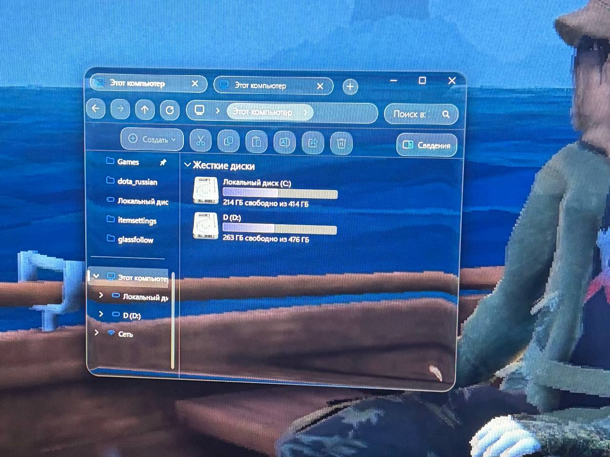

# GlassFollow

**Liquid glass** в стиле Apple (настоящее преломление на краях, а не просто блюр) за окнами в **Windows 11**.

GlassFollow ставит стеклянную поверхность, которую рисует видеокарта, прямо *под* выбранные окна и держит её
под ними, когда окна двигаются, меняют размер, переходят на другой монитор или меняют порядок. Программа
сделана для сильно кастомизированных рабочих столов, где приложения уже прозрачные (Zen Browser, Проводник,
Discord с Vencord, Steam с Millennium, Windows Terminal и другие).

> English version: [README.md](README.md)

<!-- Добавь скриншот или GIF: docs/preview.png -->
<!--  -->

## Как это работает

1. Экран захватывается через `Windows.Graphics.Capture` (по сессии на каждый монитор, без курсора и рамки).
2. Пиксельный шейдер из [correct-liquid-glass](https://github.com/Shram1404/correct-liquid-glass) искажает
   захваченную картинку у краёв окна (преломление, фаска, блики).
3. Результат показывается в безрамочном окне **прямо под** целевым окном, обрезанном по его скруглённой форме.
   Чтобы стекло было видно, **целевое приложение должно быть прозрачным**.
4. Окна стекла скрыты от захвата (`WDA_EXCLUDEFROMCAPTURE`), поэтому стекло не преломляет само себя.
   Необязательный мод Windhawk скрывает от захвата и *целевые* окна, иначе стекло преломляло бы содержимое
   самого приложения.
5. Перерисовка идёт только когда пиксели под окном действительно изменились. Пока в фокусе полноэкранное
   приложение (игра), программа полностью на паузе.

## Требования

- Windows 11 22H2 или новее (нужные функции захвата и DWM появились в сборке 22621+).
- [.NET 10 Runtime](https://dotnet.microsoft.com/download/dotnet/10.0) (x64).
- Видеокарта с Direct3D 11.
- [Windhawk](https://windhawk.net) для мода `glass-prep` (рекомендуется, см. ниже).
- Приложения, которые умеют быть прозрачными.

## Быстрый старт

1. Скачай последний zip из **Releases** и распакуй в постоянную папку.
2. Установи мод Windhawk (см. [Мод Windhawk](#мод-windhawk)).
3. Запусти в PowerShell из распакованной папки:

```powershell
.\GlassFollow.exe --thick 60 zen explorer:CabinetWClass "explorer:#32770" discord WindowsTerminal
```

Остановка: `Ctrl+C` (или `Stop-Process -Name GlassFollow`, если запущено скрыто).

## Командная строка

```
GlassFollow.exe [опции] <спецификация> [<спецификация> ...]
GlassFollow.exe --list [--delay N]
```

| Опция | По умолчанию | Значение |
|---|---|---|
| `--corner N` | `22` | Радиус скругления в пикселях (при масштабе 100%). |
| `--thick N` | `36` | Толщина края стекла. Больше значение, шире зона преломления. Автор использует `180`. |
| `--fps N` | `200` | Ограничение кадров. Поставь частоту своего монитора. |
| `--pad N` | `16` | Отступ вокруг окна для выборки пикселей. Увеличивай вместе с `--thick`. |
| `--hidden` | выкл. | Скрыть окно консоли (для автозапуска). |
| `--no-shot` | выкл. | Не следить за Win+Shift+S / PrtScn (см. [Скриншоты](#скриншоты)). |
| `--setup` | | Открыть интерактивную настройку автозапуска (см. [Автозапуск](#автозапуск)) и выйти. |
| `--list` | | Вывести видимые окна (процесс, класс, размер, заголовок) для составления спецификаций и выйти. |
| `--delay N` | `0` | С `--list`: подождать N секунд, чтобы успеть открыть нужное окно. |

### Спецификации окон

```
процесс[:КлассОкна[:ЧастьЗаголовка]]
```

- `процесс`: имя процесса без `.exe`; `*` подходит для любого процесса.
- `КлассОкна` может заканчиваться на `*` (сравнение по префиксу).
- Просто `процесс` подходит только для обычных окон верхнего уровня. Если указан класс или заголовок, то
  разрешены ещё дочерние окна (диалоги), tool-окна и тонкие окна (лаунчеры).
- Спецификации с `#` или `*` бери в кавычки.

Спецификации, которые работали у автора:

| Приложение | Спецификация |
|---|---|
| Zen Browser | `zen` |
| Проводник | `explorer:CabinetWClass` |
| Диалоги Проводника (удаление, свойства и т.д.) | `"explorer:#32770"` |
| Discord (Vencord) | `discord` |
| Steam (Millennium) | `steamwebhelper:SDL_app` |
| Windows Terminal | `WindowsTerminal` |
| Классическое окно консоли (cmd/PowerShell) | `"*:ConsoleWindowClass"` |
| Flow Launcher | `"Flow.Launcher:HwndWrapper*"` (экспериментально) |

Классы окон могут отличаться в разных версиях программ. Если приложение не подхватывается, запусти
`GlassFollow.exe --list` и используй выведенные значения.

## Мод Windhawk

`windhawk/glass-prep.wh.cpp` это небольшой мод для [Windhawk](https://windhawk.net). В приложениях из его
строк `@include` он:

- превращает запросы Mica/Acrylic в «без бэкдропа» и применяет полностью прозрачный акцент, так что окно
  становится **просто прозрачным без блюра**;
- скрывает окна приложения от захвата экрана, чтобы стекло не преломляло само окно.

Установка: Windhawk → *Create a new mod* → вставь содержимое `glass-prep.wh.cpp` → *Compile Mod* → включи.
Список приложений меняется в строках `@include` (по умолчанию `zen.exe`, `explorer.exe`, `discord.exe`,
`steamwebhelper.exe`, `Flow.Launcher.exe`, `WindowsTerminal.exe`, `conhost.exe`, `OpenConsole.exe`).

Настройки по умолчанию (для всех приложений):

| Настройка | Значение |
|---|---|
| Hide windows from screen capture | Нужна для чистого стекла. Окна скрыты только пока работает GlassFollow, а на скриншотах видны (см. [Скриншоты](#скриншоты)). Запись и демонстрация экрана их по-прежнему не видят. |
| Transparency method | `1` прозрачный акцент (по умолчанию), `2` акцент + рамка, расширенная на клиентскую область, `3` бэкдроп «none» + расширенная рамка. Если окно остаётся чёрным или серым, пробуй следующий. |

**Настройки для отдельных приложений** (настройки мода → *Per-app settings* → добавить элемент) переопределяют
значения по умолчанию для одного процесса:

| Поле | Значение |
|---|---|
| Process name | Например, `zen.exe`. Регистр не важен. |
| Enabled | Отключить мод только для этого приложения. |
| Hide from screen capture | Своё значение вместо общего. |
| Transparency method | Свой метод вместо общего. |
| Window classes | Классы окон через запятую, `*` в конце означает префикс. Пусто = все крупные окна процесса (в `explorer.exe`: только окна Проводника и стандартные диалоги). |

Процесс должен входить и в список процессов мода (строки `@include` или *Advanced → custom process list* в
настройках мода).

Примечания:

- Прозрачность в самих приложениях всё равно должна быть включена (например, мод прозрачности Zen и
  параметры `about:config`). Мод лишь убирает блюр/Mica и непрозрачный бэкдроп.
- В `explorer.exe` мод трогает только окна Проводника и стандартные диалоги, но никогда рабочий стол, обои и
  панель задач.
- Мод работает внутри целевых процессов. Прочитай исходник перед включением, а если приложение начнёт
  глючить, сначала отключи мод.

## Скриншоты

Обычно стекло и окна приложений скрыты от захвата, поэтому простой скриншот показал бы только обои. Поэтому
GlassFollow следит за `Win+Shift+S` и `PrtScn`. Когда одна из них нажата, стекло замораживается (остаётся
как последний кадр), окна стекла становятся видимыми для захвата, а мод делает видимыми и окна приложений.
Скриншот получается таким же, как твой экран. Когда оверлей выбора области закрывается, всё возвращается
(максимум через 30 секунд, или через 3 секунды, если оверлей не появился).

- Работает со штатным инструментом скриншотов Windows. Запись экрана, OBS и демонстрация экрана по-прежнему
  не видят окна стекла и приложения.
- Без мода Windhawk видимыми становятся только окна стекла.
- Флаг `--no-shot` отключает слежение за клавишами.
- Скриншот делается через несколько десятков миллисекунд после нажатия. Если приложение иногда пропадает
  на снимке, повтори скриншот и напиши об этом в issue.

## Игры и полноэкранные приложения

Пока в фокусе окно, закрывающее весь монитор (эксклюзивный или безрамочный полный экран), GlassFollow
ставится на паузу: стекло остаётся как было, ничего не перерисовывается, а захват снижается до одного тика
в секунду. Обычные развёрнутые окна не считаются. Когда фокус уходит, работа возобновляется. Не добавляй игры
в `@include` мода.

## Автозапуск

Дважды щёлкни `GlassFollow-setup.cmd` в папке релиза или запусти `GlassFollow.exe --setup`. Откроется
интерактивное меню с ASCII-баннером, в котором можно:

- выбрать программы из готового списка и добавить свои спецификации;
- задать каждый флаг (`--corner`, `--thick`, `--fps`, `--pad`, `--no-shot` и любые другие в конец) или
  самому вписать всю командную строку;
- выбрать задержку после входа в систему;
- установить, обновить или удалить задачу автозапуска, посмотреть установленную, запустить или остановить
  GlassFollow и вывести список окон.

Выбранные значения запоминаются в `%APPDATA%\GlassFollow\autostart.json`. Задача запускает GlassFollow скрыто
(`--hidden`) после входа в систему. Windows по умолчанию блокирует `.ps1`, поэтому `.cmd` и `--setup` запускают
скрипт с `-ExecutionPolicy Bypass` только для него.

Для автоматизации есть неинтерактивный установщик:

```powershell
powershell -ExecutionPolicy Bypass -File .\scripts\install-autostart.ps1 -Arguments '--thick 60 zen discord "explorer:#32770"'
```

Удалить задачу можно из меню настройки или через `scripts\uninstall-autostart.ps1`. Папку нельзя перемещать:
задача указывает на exe (а `liquid-glass.hlsl` должен лежать рядом с ним).

## Если что-то не работает

| Проблема | Что попробовать |
|---|---|
| Приложение чёрное или серое вместо прозрачного | Переключи метод прозрачности в моде (1 → 2 → 3) и перезапусти приложение. Проверь, что другой мод не включает на нём Mica или блюр. |
| Стекла нет совсем | Приложение не прозрачное или спецификация не подошла. Проверь `--list`. В консоли видно, сколько окон стекла создано. |
| В стекле виден «призрак» самого окна | Мод не активен для этого приложения или выключено «Hide windows from screen capture». |
| Окно пропало со скриншота | Win+Shift+S и PrtScn должны его показывать, см. [Скриншоты](#скриншоты). Если нет, а также для записи и демонстрации экрана: так задумано, пока включено скрытие от захвата. |
| Преломление у краёв слишком тонкое или обрезается | Увеличь `--thick` и `--pad`. |
| Правка шейдера | Меняй `liquid-glass.hlsl` рядом с exe прямо во время работы, он перезагружается автоматически. |

## Ограничения

- Разработано и проверено на одном компьютере (Windows 11 сборка 26300, RTX 3060, два монитора 1080p на 200 и
  144 Гц). Другие видеокарты, ноутбуки с гибридной графикой и разные масштабы DPI на мониторах не проверялись.
- Стекло не преломляет другое стекло: окна под ним скрыты от захвата, поэтому стекло, перекрывающее другое
  стекло, показывает рабочий стол за обоими.
- Окно на стыке двух мониторов преломляет картинку с того монитора, где находится его центр.
- Каждому приложению нужна своя настройка прозрачности. Обновления приложений могут менять классы окон или
  ломать прозрачность.
- Окна, скрытые от захвата, пропадают из демонстрации и записи экрана, пока работает GlassFollow (скриншоты по Win+Shift+S / PrtScn обработаны).
- Бинарники не подписаны, поэтому SmartScreen может предупреждать.

## Сборка из исходников

Нужен [.NET 10 SDK](https://dotnet.microsoft.com/download/dotnet/10.0).

```powershell
git clone https://github.com/doshikmac-web/GlassFollow
cd GlassFollow
# сначала скопируй шейдер и его лицензию, см. third_party/README.md
dotnet build src/GlassFollow -c Release
src\GlassFollow\bin\Release\net10.0-windows10.0.26100.0\GlassFollow.exe --list
```

Тег вида `v1.0.0` запускает сборку zip-релиза в GitHub Actions (`.github/workflows/release.yml`).

## Авторы и лицензия

- Шейдер преломления и подход к захвату: [correct-liquid-glass](https://github.com/Shram1404/correct-liquid-glass),
  автор Shram1404 (MIT).
- Привязки Direct3D: [Vortice.Windows](https://github.com/amerkoleci/Vortice.Windows) (MIT).
- Платформа модов: [Windhawk](https://windhawk.net). Проект с ней не связан.

GlassFollow распространяется под лицензией MIT, см. [LICENSE](LICENSE) и
[THIRD_PARTY_NOTICES.md](THIRD_PARTY_NOTICES.md).
